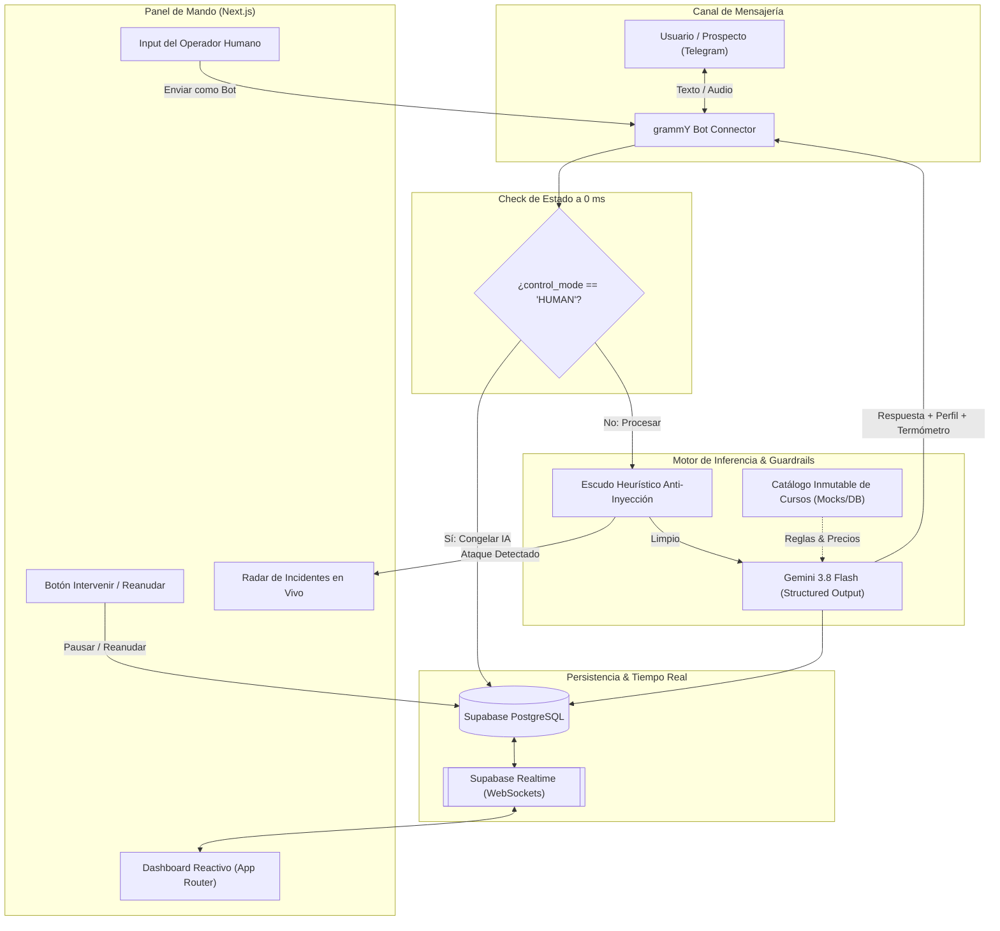

# Ecosistema Multi-Agente para Ventas & Gestión Conversacional
> **Hackathon FISEI - Universidad Técnica de Ambato (UTA 2026)**  
> *Edición Especial Ambato Meetup — Aliados: SpaceX · GDG Quito · Supabase*

Solución híbrida autónomo-humana de alta velocidad para centros de capacitación tecnológica. Combina un agente conversacional en Telegram blindado contra inyecciones de prompts con un panel de mando reactivo en tiempo real con capacidad de **Seamless Handover**.

---

## 🚀 Inicio Rápido (Quick Path)

### 1. Clonar e Instalar Dependencias
```bash
# Instalar dependencias en todo el monorepo
npm install
```

### 2. Configurar Variables de Entorno
Copia los archivos de ejemplo en cada app:
```bash
# Configurar bot de Telegram y Gemini
cp apps/bot/.env.example apps/bot/.env

# Configurar panel de control web
cp apps/web/.env.example apps/web/.env.local
```

### 3. Base de Datos (Supabase)
Pega el script ubicado en [`supabase/schema.sql`](supabase/schema.sql) en el **SQL Editor** de tu proyecto Supabase y ejecútalo. Habilita automáticamente las tablas `conversations`, `messages`, `security_logs` y la réplica Realtime.

### 4. Ejecutar en Modo Desarrollo
```bash
# Terminal 1: Iniciar el bot de Telegram
npm run dev:bot

# Terminal 2: Iniciar el Dashboard Web
npm run dev:web
```
Abre [http://localhost:3000](http://localhost:3000) para entrar al **Mission Control**.

---

## 🏛️ Arquitectura del Sistema (Mermaid)



---

## 📋 Cumplimiento de la Rúbrica Oficial (100 Puntos)

| Criterio de Evaluación | Puntaje | Implementación en la Solución |
|---|---|---|
| **A. Agente Conversacional** | **30 pts** | |
| · Capacidad de persuasión y tono | 10 pts | Prompt de perfilamiento empático con enfoque en valor académico (no catálogo frío). |
| · Identificación de intención y cierre | 10 pts | Clasificador de estado (`INTERESTED`, `DOUBTFUL`, `FRUSTRATED`, `HOT_LEAD`). |
| · Resiliencia ante casos de borde e inyecciones | 10 pts | Escudo heurístico + Sandwiching XML `<user_input>` + Catálogo inmutable. |
| **B. Panel de Control Web y Handover** | **30 pts** | |
| · Sincronización bidireccional en tiempo real | 10 pts | Supabase Realtime nativo sin recarga manual de pantalla ni servidores de sockets manuales. |
| · Mecanismo de handover y pausa de IA | 10 pts | Semáforo `control_mode`: al intervenir el operador, la inferencia se congela a 0 ms. |
| · Diseño UI/UX y termómetro en vivo | 10 pts | Interfaz estilo SaaS moderno con Tailwind, semáforos de lead y tarjetas ergonómicas. |
| **C. Arquitectura, Integración y Eficiencia** | **20 pts** | |
| · Diseño modular y separación de capas | 10 pts | Monorepo limpio: `apps/bot`, `apps/web` y `packages/shared` desacoplados. |
| · Gestión de tokens y ventana de contexto | 10 pts | Mantenimiento de `lead_memory` JSONB + historial compacto de últimos turnos ($O(1)$ tokens). |
| **D. Innovación, Valor Agregado y Demo** | **20 pts** | |
| · Funcionalidades complementarias | 10 pts | Copiloto de Handover ("Whisper Summary") + Radar visual de ataques en tiempo real. |
| · Sustentación técnica y estabilidad en vivo | 10 pts | Respuestas sub-segundo con Gemini 3.8 Flash y arquitectura de cero fallos de CORS. |

---

## 📦 Estructura del Proyecto

```text
hackaton/
├── apps/
│   ├── bot/                 # Backend: grammY + Gemini Flash + Guardrails
│   │   ├── src/
│   │   │   ├── bot.ts       # Manejo de eventos de Telegram
│   │   │   ├── services/    # gemini.service, guardrail.service, supabase.service
│   │   │   └── index.ts     # Entrypoint
│   └── web/                 # Frontend: Next.js App Router + Tailwind + Supabase Realtime
│       ├── src/
│       │   ├── app/         # Dashboard Page & Handover API Routes
│       │   └── components/  # LeadThermometer, SecurityRadar
├── packages/
│   └── shared/              # Contratos comunes (Zod Schemas, Types, Mock Courses)
├── supabase/
│   └── schema.sql           # Script SQL para tablas y replicación Realtime
└── README.md
```

---

## 👥 Equipo de Desarrollo
Proyecto presentado para el **Reto Oficial Hackathon 2026** de la **Facultad de Ingeniería en Sistemas, Electrónica e Industrial (FISEI - UTA)**.
